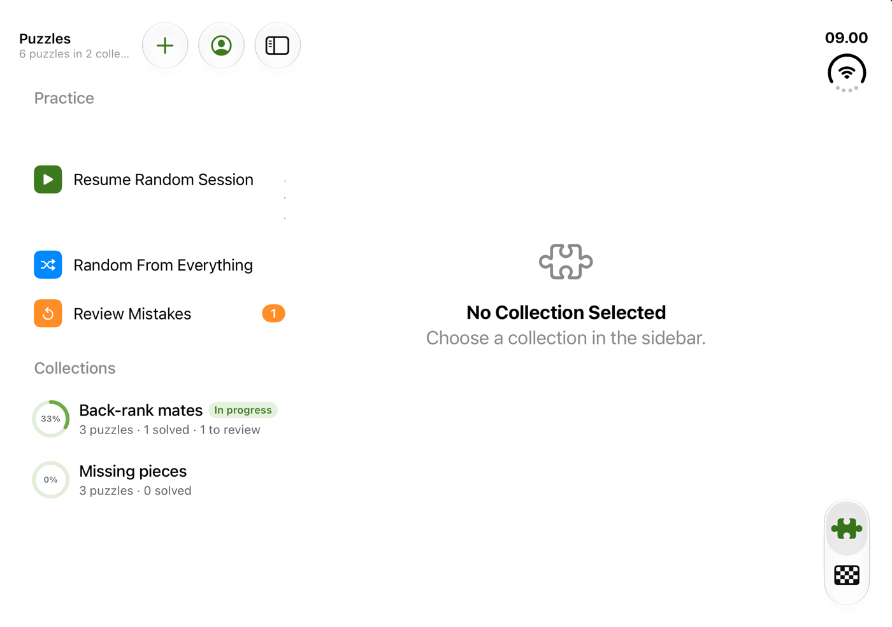

# 1. Practice row breaks in the sidebar

**Severity:** High
**Where:** Inner display wide (IL) and half-folded book pose (FB): Puzzles sidebar
**Code:** `iOS/Motif/Motif/UI/Puzzles/PuzzlesHomeView.swift:56-58, 113-115`



## What happens

The "Resume Random Session" row is about three times as tall as its neighbours, and its
trailing "5 left" is a one-character-wide sliver at the right edge, so the count can't be
read. The same row is fine on the outer display, where the row is wider.

## Why

`PracticeRow` gives the title `layoutPriority(1)` and puts a `Spacer()` before the
trailing view, which has no size of its own. In the 300–360 pt sidebar column the title
takes all the width, the trailing `Text` is offered almost zero, and it wraps one
character per line, which makes the row tall.

## Fix

Let the trailing detail keep its size and let the title wrap instead:

```swift
// PracticeRow.body
HStack(spacing: 12) {
    IconTile(systemImage: systemImage, color: tile.opacity(enabled ? 1 : 0.4))
    Text(title).foregroundStyle(enabled ? Color.primary : Color.motifSecondaryText).lineLimit(2)
    Spacer(minLength: 8)
    trailing.fixedSize()
}
```

Check it on IL, FB and with the largest text sizes.
