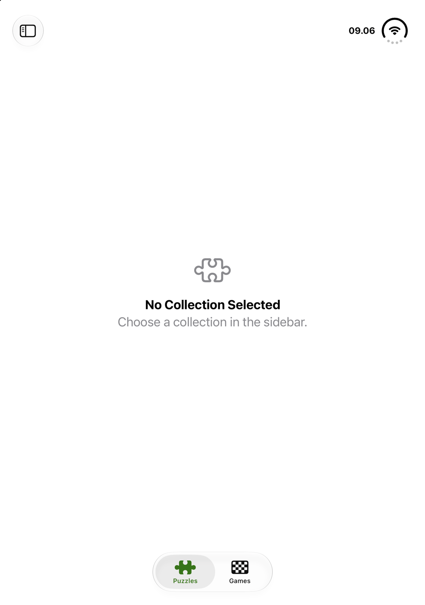

# 2. Open tall with nothing selected hides the sidebar

**Severity:** High
**Where:** Inner display tall (IP): Puzzles and Games tabs
**Code:** `iOS/Motif/Motif/App/RootView.swift:164-169`, `iOS/Motif/Motif/App/AppState.swift:207-210`



## What happens

Opened tall with no collection selected, the tab shows only "No Collection Selected —
Choose a collection in the sidebar." The sidebar isn't on screen, so Import Puzzles,
Account and the collections are reachable only through the small sidebar button at the
top left. The Games tab behaves the same way.

## Why

`TabColumns.settle` asks for `.all` when nothing is selected (decision 16), but on this
pose the split view still shows the detail alone. Apple's guidance:
`designing-for-iphone-duo.md › Best practices`: "Maintain the same functionality across
device poses … Provide access to the same controls and content regardless of how
someone holds or views the device."

The capture suite misses it: on regular poses the homes launch with the `select`
fixture, which preselects a collection.

## Fix

Pick one:

- Open tall with nothing selected, select the first (or most recently used) collection,
  the way Mail opens a message beside its list.
- Or give the tall empty state an action that brings the sidebar back:

```swift
// NoSelection, when openTall
ContentUnavailableView {
    Label("No Collection Selected", systemImage: systemImage)
} description: {
    Text("Choose a collection to start.")
} actions: {
    Button("Show Collections") { showSidebar() }   // sets the tab's columns.visibility = .all
}
```

Also add an IP capture of S04a and S11a without the `select` fixture.
