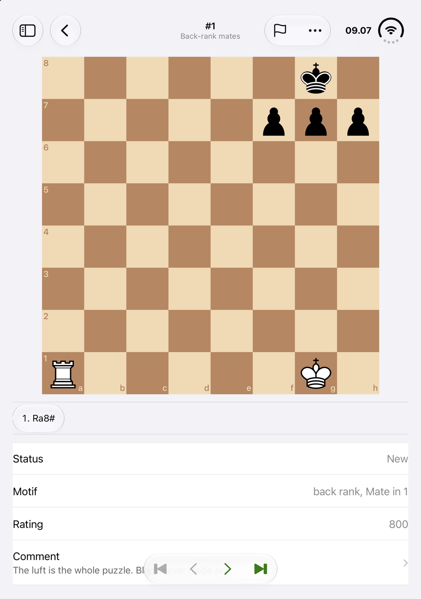
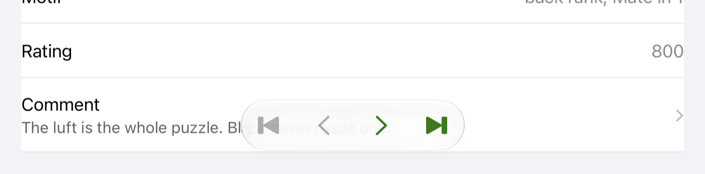

# 3. Puzzle detail: replay bar covers the Comment row

**Severity:** Medium
**Where:** Inner display tall (IP): puzzle detail
**Code:** `iOS/Motif/Motif/UI/Puzzles/PuzzleDetailView.swift:67`




## What happens

At rest, the floating Go to Start / Previous / Next / Go to End bar sits on top of the
Comment row, so the comment text ("The luft is the whole puzzle. Bl…") is hidden behind it.

## Why

`BoardLayout` sizes the board on IP so the list keeps `minColumnHeight` (240 pt). The
move chips plus Status, Motif, Rating and Comment need about 280 pt, so the last row ends
under the bottom bar.

## Fix

Give this screen a taller column, at the cost of about 56 pt of board on IP:

```swift
let layout = BoardLayout(container: container, compact: sizeClass == .compact, evalBar: false,
                         minColumnHeight: 300, division: division)
```

Or keep the board and add a bottom content margin the height of the bar to the list.
