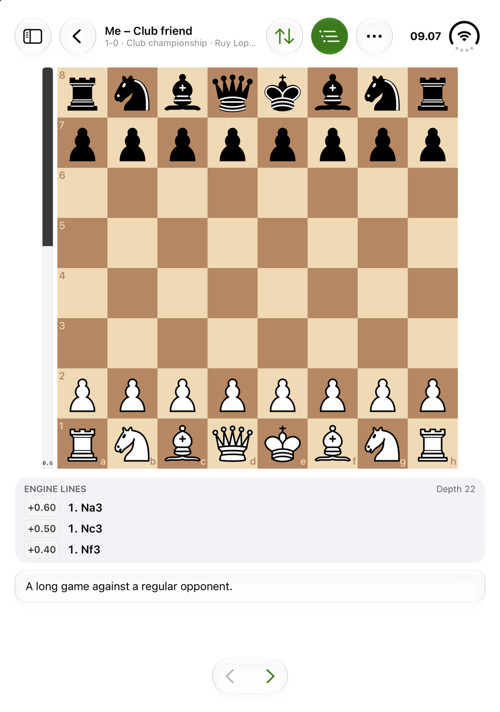
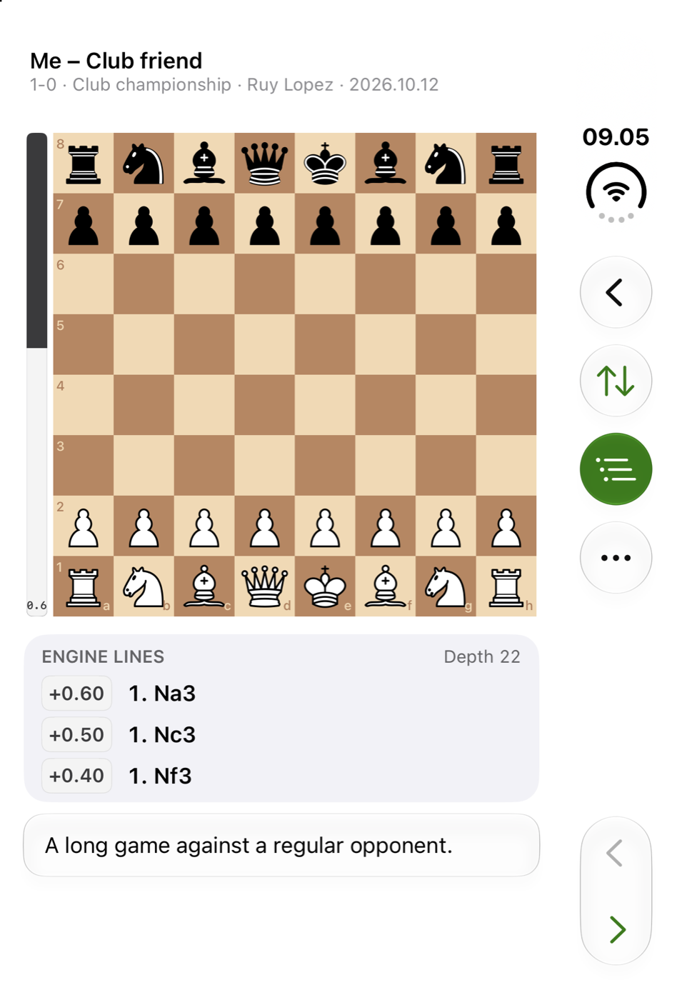

# 4. Analysis: move list hidden despite free space

**Severity:** Medium
**Where:** Inner display tall (IP), and outer display (O): Analysis view with engine lines on
**Code:** `iOS/Motif/Motif/UI/Games/GameView.swift:155`, `iOS/Motif/Motif/UI/Board/BoardLayout.swift:50, 59`




## What happens

With engine lines shown, the column under the board shows the lines and the comment, then
about 90 pt of empty space above the bottom bar. The moves of the game aren't shown at all.

## Why

`BoardLayout.short` is true when the column is under 300 pt (about 244 pt on IP), and
`GameView` drops `MoveListView` entirely when the column is short and the lines are on.
It's all or nothing, so the leftover space goes unused.

## Fix

Keep the move list and let it take whatever height is left:

```swift
MoveListView(game: tree, path: model.path, go: model.go) { moveMenu($0) }
    .frame(minHeight: 0, maxHeight: .infinity)
```

Or, in a short column, show the moves as one horizontally scrolling row, as the
alternatives already do.
