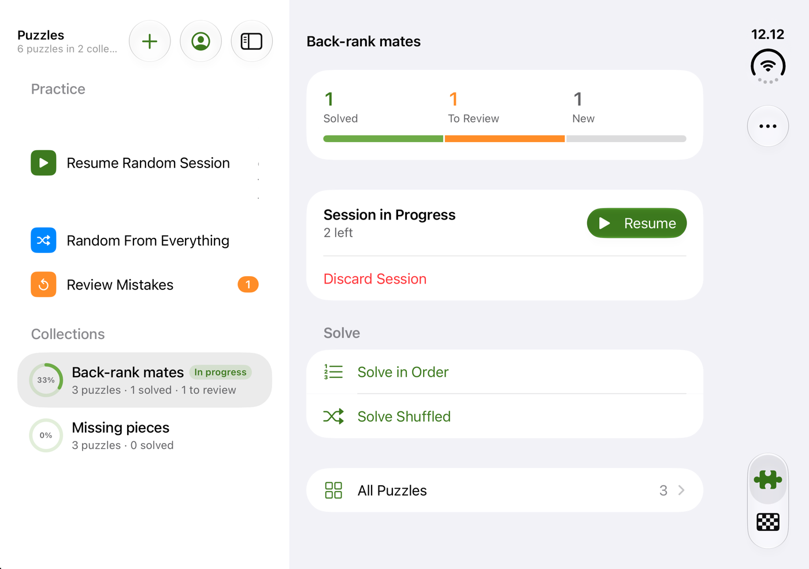

# 5. Sidebar subtitle truncated

**Severity:** Low
**Where:** Inner display wide (IL) and book pose (FB): Puzzles and Games sidebars
**Code:** `iOS/Motif/Motif/UI/Puzzles/PuzzlesHomeView.swift:35`, `iOS/Motif/Motif/UI/Games/GamesHomeView.swift:30`



## What happens

The sidebar's subtitle reads "6 puzzles in 2 colle…" and "9 games in 2 collec…": Import,
Account and the sidebar button, with a fixed spacer between them, leave too little room in
the 340 pt column.

## Why

`designing-for-iphone-duo.md › Vertical controls`: "Group related toolbar items instead
of spacing them manually … avoid adding fixed spacing yourself."

## Fix

Remove the `ToolbarSpacer(.fixed, …)` and put both buttons in one group:

```swift
ToolbarItemGroup(placement: .topBarTrailing) {
    Button("Import Puzzles", systemImage: "plus") { app.importingPuzzles = true }
        .disabled(!app.store.online).accessibilityIdentifier("import-puzzles")
    AccountButton()
}
```

Keep Account's high visibility priority on the group, or keep the two as separate items
without the spacer. If the subtitle still doesn't fit, shorten it ("6 puzzles · 2 collections").
